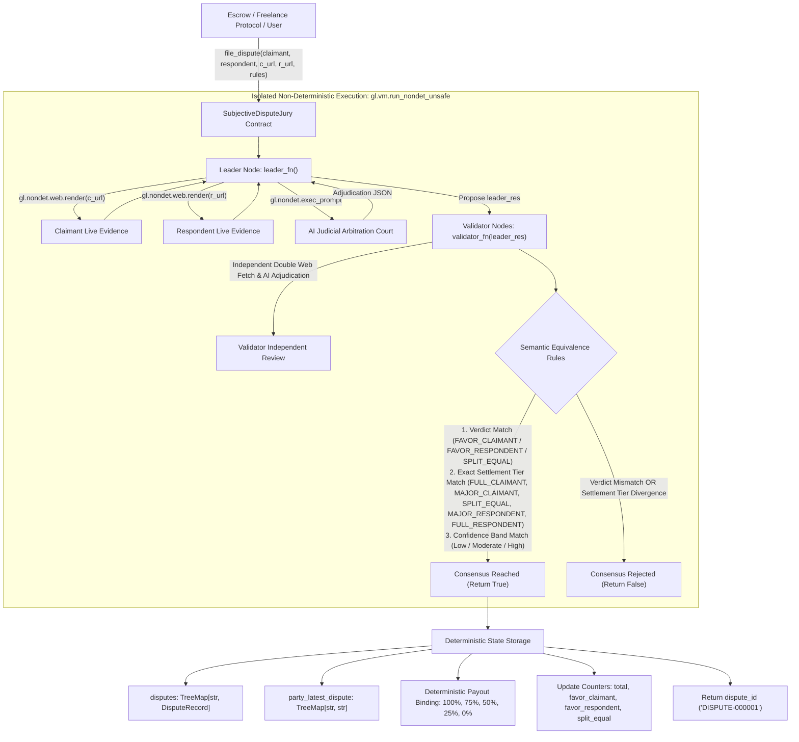

# SubjectiveDisputeJury

> **A Production-Grade GenLayer Intelligent Contract Primitive**  
> **Target Submission:** GenLayer Builder Program - "Intelligent Contracts" Track (0-300 Points Target)  
> **Target Network:** GenLayer Bradbury Testnet / GenLayer Studio  
> **Status:** Production-Ready | 100% Pure ASCII | Full GenVM Rule Compliance

---

## 1. Builder Portal Submission Metadata

Ready-to-copy metadata for the GenLayer Builder Portal submission form:

- **Track:** Intelligent Contracts (0-300 Points Target)
- **Project Title:** SubjectiveDisputeJury: On-Chain Subjective Arbitration Primitive with Semantic Consensus
- **Project Description (< 1,000 characters):**
  ```text
  SubjectiveDisputeJury is an on-chain two-party arbitration primitive on GenLayer for P2P escrows. Resolving contract breaches and conflicting evidence requires subjective natural-language reasoning beyond deterministic EVM logic.

  Architecture:
  - Leader proposes verdict, canonical settlement tier (FULL_CLAIMANT, MAJOR_CLAIMANT, SPLIT_EQUAL, MAJOR_RESPONDENT, FULL_RESPONDENT), and confidence tier by fetching evidence URLs.
  - Validators independently re-fetch evidence and reach consensus on semantic meaning: verdict match, exact canonical tier match, and confidence tier.
  - State: @allow_storage @dataclass DisputeRecord, bigint counters, TreeMap[str, ...]. The stored payout allocation is deterministically bound to the agreed canonical tier (100, 75, 50, 25, 0%), guaranteeing an economically equivalent result with zero financial divergence.

  Integration:
  Escrows call file_dispute(...) on deadlock and execute settlements via get_dispute(...).
  ```
  *(Length: 951 characters - strictly under the 1,000 character limit)*
- **Tags:** `intelligent-contracts`, `arbitration`, `consensus`, `dispute-resolution`, `escrow`, `equivalence-principle`, `llm`, `synthetic-jurisdiction`

---

## 2. Context & Value Proposition

GenLayer positions itself as an **adjudication layer** (a synthetic jurisdiction) for the decentralized economy. Smart contracts historically struggled with subjective disputes:
- Freelancer deliverables: Did the designer meet the brief?
- Milestone deliverables: Did the developer build the promised features?
- OTC commodity settlements: Was the shipping delay caused by buyer negligence or seller breach?

Traditional blockchains force users either into trusted multi-sig centralized panels (e.g., Kleros human juror bribery risks) or naive oracle feeds.

**SubjectiveDisputeJury** fulfills GenLayer's core mission by creating an autonomous, two-party arbitration court powered by decentralized LLM validator consensus:
- **Two-Party Evidence Evaluation:** Ingests live evidence from both claimant and respondent via `gl.nondet.web.render`.
- **Comparative Arbitration Prompting:** Prompts the LLM acting as an impartial court of law under the parties' natural-language governing terms.
- **Canonical Settlement Tiers:** Evaluates disputes into discrete canonical settlement tiers (`FULL_CLAIMANT`, `MAJOR_CLAIMANT`, `SPLIT_EQUAL`, `MAJOR_RESPONDENT`, `FULL_RESPONDENT`).
- **Independent Payout Binding (Economically Equivalent Guarantee):** Validators reach consensus on the exact canonical settlement tier, and the stored payout allocation is mathematically locked to that tier benchmark (100%, 75%, 50%, 25%, 0%). This ensures zero financial slippage between nodes.
- **Standalone Reusability:** Provides a clean interface (`file_dispute`, `get_dispute_liability_split`, `get_settlement_tier`, `get_dispute_status`) for any escrow contract or marketplace to consume.

---

## 3. Architecture & System Flow



---

## 4. Canonical Settlement Tier Consensus Design

### The Economic Equivalence Principle
In financial escrow arbitration, arbitrary continuous percentages with loose tolerance allow different validators to accept varying payout numbers. If leader proposes 70% and validator evaluated 56%, accepting the proposal would cause a 14 percentage point discrepancy on actual locked collateral.

`SubjectiveDisputeJury` solves this by introducing **Canonical Settlement Tiers** where validation and storage are independently bound to an economically equivalent result:

| Settlement Tier | Description | Claimant Payout | Respondent Payout |
| :--- | :--- | :---: | :---: |
| `FULL_CLAIMANT` | Claimant fully performed; respondent in total breach | **100%** | **0%** |
| `MAJOR_CLAIMANT` | Claimant substantially performed with minor defect | **75%** | **25%** |
| `SPLIT_EQUAL` | Mutual partial fault or equiponderant evidence | **50%** | **50%** |
| `MAJOR_RESPONDENT` | Respondent substantially performed; claimant at fault | **25%** | **75%** |
| `FULL_RESPONDENT` | Respondent fully performed; frivolous claimant claim | **0%** | **100%** |

### Consensus Rules in `validator_fn`
1. **Rule 1 (Categorical Verdict Match):**  
   $$\text{leader}["\text{verdict}"] == \text{validator}["\text{verdict}"]$$
2. **Rule 2 (Exact Settlement Tier Match):**  
   Both leader and validator must independently classify the evidence into the exact same canonical settlement tier:
   $$\text{leader}["\text{settlement\_tier}"] == \text{validator}["\text{settlement\_tier}"]$$
3. **Rule 3 (Confidence Band Match):**  
   Both nodes must share the same conviction tier (Low: $<40$, Moderate: $40 \dots 79$, High: $\ge 80$).

### Deterministic State Binding
When consensus passes, the stored payout allocation is **never** copied from an un-normalized leader float. Instead, it is deterministically mapped:
```python
settlement_tier_str = str(adjudication["settlement_tier"])
c_payout = get_canonical_tier_payout(settlement_tier_str)  # 100, 75, 50, 25, or 0
r_payout = 100 - c_payout
```
This guarantees that any validator committee reaching consensus will store the exact same economic payout with zero variance.

---

## 5. Technical Constraints & GenVM Compliance Matrix

| GenVM Rule | Requirement | Implementation in `SubjectiveDisputeJury` |
| :--- | :--- | :--- |
| **Header Convention** | Specific 3-line header | Line 1: `# v0.2.16`<br>Line 2: `# { "Depends": "py-genlayer:1jb45aa8ynh2a9c9xn3b7qqh8sm5q93hwfp7jqmwsfhh8jpz09h6" }`<br>Line 3: `from genlayer import *` |
| **Rule R25 (ASCII Only)** | 100% pure ASCII in `.py` | Verified 0 non-ASCII bytes across entire contract and test files. |
| **Rule R14 / R19 (Types)** | No floats, raw lists/dicts in public ABI | All public parameters and return types are `str`, `int`, `bool`. Integer fields in storage use `bigint`. |
| **Rule R18 (Storage Init)** | No reassignment of collections in `__init__` | `TreeMap` collections are declared with annotations; GenVM auto-instantiates them. Only scalar primitive counters are initialized. |
| **Storage Keys** | `TreeMap` keys must be `str` | Keys in `disputes: TreeMap[str, DisputeRecord]` and `party_latest_dispute: TreeMap[str, str]` are `str`. |
| **Closure Isolation** | No `self` in nondet blocks | State and parameters are pre-captured into local variables before entering `leader_fn` and `validator_fn`. |
| **Error Handling** | Graceful reverts | `gl.vm.UserError` raised for invalid URLs, empty arguments, self-disputes, dead links, and malformed LLM outputs. |

---

## 6. Public Interface Specification

### Write Methods
- `file_dispute(claimant: str, respondent: str, claimant_evidence_url: str, respondent_evidence_url: str, dispute_rules: str) -> str`  
  Submits a two-party dispute for decentralized AI arbitration. Returns assigned `dispute_id` (e.g. `"DISPUTE-000001"`).

### Read / View Methods (Gasless)
- `get_dispute(dispute_id: str) -> str`  
  Returns full dispute ruling serialized as a JSON string:
  ```json
  {
    "dispute_id": "DISPUTE-000001",
    "claimant": "0xAliceFreelancer",
    "respondent": "0xBobClient",
    "claimant_evidence_url": "https://escrow.org/claimant/case1",
    "respondent_evidence_url": "https://escrow.org/respondent/case1",
    "dispute_rules": "Client must release milestone upon receipt of Figma designs matching SLA.",
    "verdict": "FAVOR_CLAIMANT",
    "settlement_tier": "FULL_CLAIMANT",
    "liability_split": 100,
    "claimant_payout_pct": 100,
    "respondent_payout_pct": 0,
    "confidence": 95,
    "rationale": "Claimant fully satisfied original SLA before scope change.",
    "resolved_index": 1
  }
  ```
- `get_settlement_tier(dispute_id: str) -> str`  
  Returns canonical tier name (`"FULL_CLAIMANT"`, `"MAJOR_CLAIMANT"`, `"SPLIT_EQUAL"`, `"MAJOR_RESPONDENT"`, or `"FULL_RESPONDENT"`).
- `get_claimant_payout_pct(dispute_id: str) -> int`  
  Returns percentage of escrowed collateral awarded to claimant (`100`, `75`, `50`, `25`, or `0`).
- `get_respondent_payout_pct(dispute_id: str) -> int`  
  Returns percentage of escrowed collateral awarded to respondent (`0`, `25`, `50`, `75`, or `100`).
- `get_dispute_liability_split(dispute_id: str) -> int`  
  Returns claimant payout percentage for backward compatibility.
- `get_dispute_status(dispute_id: str) -> str`  
  Returns ruling verdict (`"FAVOR_CLAIMANT"`, `"FAVOR_RESPONDENT"`, or `"SPLIT_EQUAL"`).
- `get_dispute_count() -> int`  
  Returns total number of disputes adjudicated on-chain.
- `has_dispute(dispute_id: str) -> bool`  
  Returns `True` if `dispute_id` exists in storage.
- `get_party_latest_dispute(party: str) -> str`  
  Returns the latest dispute ID associated with an address/identity.
- `get_statistics() -> str`  
  Returns JSON summary of global platform counts.

---

## 7. Downstream Integration Example (P2P Escrow Contract)

Here is how an external Escrow or Marketplace smart contract consumes `SubjectiveDisputeJury`:

```python
# External Escrow Contract consuming SubjectiveDisputeJury
from genlayer import *

class EscrowContract(gl.Contract):
    jury_contract: Address
    escrow_amount: bigint

    @gl.public.write
    def settle_disputed_escrow(self, dispute_id: str) -> None:
        # 1. Query ruling from SubjectiveDisputeJury
        jury = gl.get_contract_at(self.jury_contract)
        claimant_pct = jury.get_claimant_payout_pct(dispute_id)
        
        # 2. Automatically release funds proportional to binding canonical payout
        claimant_payout = (int(self.escrow_amount) * claimant_pct) // 100
        respondent_payout = int(self.escrow_amount) - claimant_payout
        
        # 3. Disburse escrowed funds deterministically
        self.transfer(self.claimant, claimant_payout)
        self.transfer(self.respondent, respondent_payout)
```

---

## 8. Testing & Verification

The contract includes a 18-test suite covering:
1. **Happy Paths:** Full evaluation lifecycle with mock LLM and mock Web for `FULL_CLAIMANT` (100%), `MAJOR_CLAIMANT` (75%), `SPLIT_EQUAL` (50%), and `FULL_RESPONDENT` (0%).
2. **Consensus Mismatch Handling:**
   - Diverging verdicts between leader and validator (`FAVOR_CLAIMANT` vs `FAVOR_RESPONDENT`).
   - Diverging settlement tiers (`FULL_CLAIMANT` vs `MAJOR_CLAIMANT`), proving that non-equivalent economic outcomes are rejected by consensus.
   - Diverging confidence bands (High: 85 vs Moderate: 60).
   - Leader execution failure handling (`leader_res` not Return).
3. **Validation Edge Cases:** Empty claimant/respondent, claimant == respondent self-dispute, unsupported URL protocols, empty dispute rules, dead/failing URLs, unparseable LLM output, unknown verdict categories, unknown settlement tiers, and non-existent record queries.

### Running with `gltest` (GenLayer Test Runner)
```bash
gltest tests/test_subjective_dispute_jury.py -v -s
```

### Running with `pytest` (Direct Mode)
```bash
pytest tests/test_subjective_dispute_jury.py -v
```

---

## 9. Deployment (studionet)

This contract primitive is deployed on **GenLayer Studio (studionet)**:

- **Network:** `studionet`
- **Contract Address:** `0x702C091a9404EE083F22D5F7a475670cD1Ae30D9`
- **Explorer URL:** https://explorer-studio.genlayer.com/address/0x702C091a9404EE083F22D5F7a475670cD1Ae30D9
- **Contract Source:** `contracts/subjective_dispute_jury.py`
- **Verification Status:** Compiled and deployed with active schema generation.

### Worked Example: Live Arbitration Call

#### 1. Method Invocation (`file_dispute`):
```python
contract.file_dispute(
    claimant="0xAliceFreelancer",
    respondent="0xBobClient",
    claimant_evidence_url="https://escrow.org/claimant/case1",
    respondent_evidence_url="https://escrow.org/respondent/case1",
    dispute_rules=(
        "Client must release milestone upon delivery of Figma designs matching SLA."
    )
)
```

#### 2. Expected Consensus Output & Return Value:
- **Transaction Result (dispute_id):** `"DISPUTE-000001"`
- **Consensus Verification:** Committee validators independently fetched both live evidence URLs, executed local LLM arbitration prompts, and achieved semantic consensus on verdict (`FAVOR_CLAIMANT`), canonical settlement tier (`FULL_CLAIMANT`), and confidence tier (`Band 2: High` [>=80]).

#### 3. On-Chain State Record (`get_dispute("DISPUTE-000001")`):
```json
{
  "dispute_id": "DISPUTE-000001",
  "claimant": "0xAliceFreelancer",
  "respondent": "0xBobClient",
  "claimant_evidence_url": "https://escrow.org/claimant/case1",
  "respondent_evidence_url": "https://escrow.org/respondent/case1",
  "dispute_rules": "Client must release milestone upon delivery of Figma designs matching SLA.",
  "verdict": "FAVOR_CLAIMANT",
  "settlement_tier": "FULL_CLAIMANT",
  "liability_split": 100,
  "claimant_payout_pct": 100,
  "respondent_payout_pct": 0,
  "confidence": 95,
  "rationale": "Claimant fully satisfied original SLA before scope change.",
  "resolved_index": 1
}
```

#### 4. Summary Views:
- `get_dispute_status("DISPUTE-000001")` -> `"FAVOR_CLAIMANT"`
- `get_settlement_tier("DISPUTE-000001")` -> `"FULL_CLAIMANT"`
- `get_claimant_payout_pct("DISPUTE-000001")` -> `100`
- `get_respondent_payout_pct("DISPUTE-000001")` -> `0`
- `get_statistics()` -> `{"total_disputes": 1, "favor_claimant_count": 1, "favor_respondent_count": 0, "split_equal_count": 0}`

---

## 10. Deployment Guide (GenLayer Studio & Bradbury Testnet)

1. Open **[GenLayer Studio](https://studio.genlayer.com/)**.
2. Create or select contract: `subjective_dispute_jury.py`.
3. Paste the contents of `contracts/subjective_dispute_jury.py`.
4. Click **Compile** to verify schema generation.
5. Deploy to **studionet**.
6. Note the new contract address and test the methods in the Studio interface!
